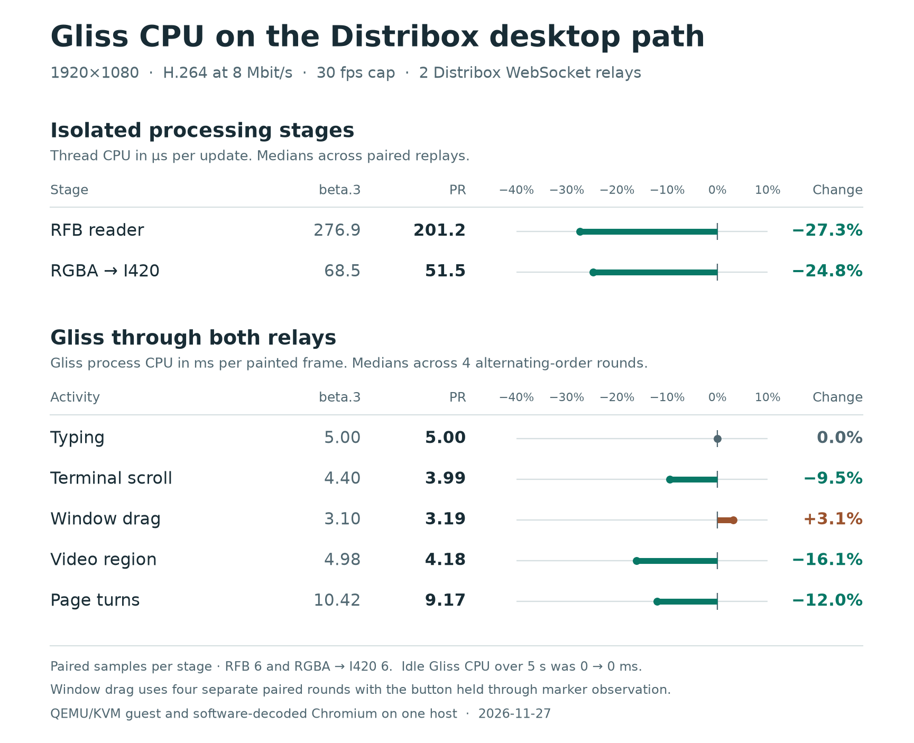

# Less CPU per Distribox framebuffer update

The local Distribox backend at the time of measurement ran Gliss beta.3 at 1920×1080, 30 fps, an 8 Mbit/s H.264 target and eight frames in flight.

The RFB reader used **27.3% less CPU per update** across three captured desktop activities. Preparing the H.264 encoder’s I420 planes used **24.8% less CPU per update** across five. Both figures compare the PR to beta.3 on the same hardware.

## Where the CPU went

**Reading QEMU rectangles.** Four sampled scroll updates contained 8,861 Raw rectangles. Gliss used to return to the async reader and reacquire exclusive framebuffer access for each rectangle. It now converts complete rows from the current read buffer and decodes consecutive complete Raw rectangles while it holds the framebuffer. Split pixels, other RFB encodings, and scheduled yields continue through the regular decoder. Scrolling reader CPU fell from **432 to 218 µs/update**. Dragging fell from **83.4 to 66.7 µs**. Page turns had only 15 rectangles across four updates and took **316.1 → 316.6 µs**.

**Preparing H.264 input.** The AVX2 converter now applies the BT.601 coefficients to packed RGBA bytes and computes each chroma sample from the rounded mean of four pixels. The previous kernel extracted R, G and B into separate vectors. Full-frame conversion fell from **549 to 445 µs**. The scalar tail and non-AVX2 path use the existing conversion. Differential tests compared every byte of the I420 planes and the encoded packets across frame changes, resets, and resizes.

The native replays use QEMU’s recorded rectangle coordinates and deterministic pixel values. The instrumented QEMU run supplied geometry only. Six before/after pairs ran in alternating order on the same host using Linux thread CPU time. The reader number gives scroll, drag, and page turns equal weight. The preparation number is the geometric mean for typing, scroll, drag, video, and page turns. Full-frame conversion is reported separately. All six pairs improved for each aggregate.

## Through both Distribox relays

A diskless QEMU/KVM guest served its virtio display over VNC. Each build ran its embedded browser client in Chromium through the checkout’s slave and master WebSocket forwarding functions in separate Uvicorn processes. The relays used loopback, and Chromium used software decoding. The React shell, nginx, TLS, physical display and WAN latency are outside this measurement.

At **8 Mbit/s**, median Gliss CPU per painted frame fell **9.5% while scrolling**, **16.1% during video** and **12.0% during page turns**. Window dragging used **3.1% more Gliss CPU**, or about 0.10 ms/frame. Typing measured 5.00 ms/frame on both builds. The five-second idle window measured zero Gliss CPU ticks on both. The table gives medians of four before/after rounds, reversing order each round. Total CPU includes Gliss, QEMU, Chromium and both relays.

| Activity | Gliss CPU, ms/frame | Total CPU, ms/frame | Distinct motion fps | Input to Canvas, p50 ms |
| --- | ---: | ---: | ---: | ---: |
| Typing | 5.00 → 5.00 | 40.00 → 36.88 | — | 34.8 → 28.8 |
| Terminal scroll | 4.40 → 3.99 | 24.01 → 22.38 | 29.9 → 30.1 | 40.5 → 36.8 |
| Window drag | 3.10 → 3.19 | 20.23 → 21.13 | 30.0 → 30.0 | 36.3 → 36.4 |
| Video region | 4.98 → 4.18 | 23.03 → 19.35 | 29.9 → 29.9 | — |
| Page turns | 10.42 → 9.17 | 51.25 → 40.42 | — | 51.3 → 48.1 |

The original drag run missed the last of 480 positions in one PR round. It released the button 9.4 ms after the final move, and the guest’s last visible position was the previous one. The benchmark now releases the button after the 1.5 s observation window. The drag row uses four new paired rounds with that correction. All 3,837 sent positions in those rounds were accounted for by the window reaching or passing them. The original rounds are in the archive.

At the **2 Mbit/s default**, two further paired rounds measured Gliss CPU of 3.75 → 3.42 ms/frame for scrolling (−8.7%), 3.46 → 3.44 for dragging (−0.6%), and 4.12 → 4.13 for video (+0.2%). Dragging and video each recorded the same median total Gliss CPU on both builds. Their small per-frame differences come from the frame counts. Median media traffic during dragging was 1.38 → 1.46 Mbit/s, and during scrolling it was 1.02 → 1.06 Mbit/s. Each live session captures its own guest updates.

The host was a shared 20-thread Intel i5-13600KF. Its one-minute load average rose from 36 to 61 during the main comparison. Scrolling and video each used less Gliss CPU in three of four pairs. Page turns used less in two pairs, tied in one and used more in one. The guest reported 19 skipped animation ticks in those eight sessions. Gliss process CPU is sampled in 10 ms ticks, which makes the eight-frame typing windows particularly coarse. The repeated native replays give the clearest evidence for the size of each code change.

## Experiments and reproduction

The conversion hill climb kept one of four trials. Word-level damage scans, a different chroma shuffle, and a rounded multiply did not clear the selection threshold. The reader hill climb kept three of six trials, first batching rows, then amortizing ownership checks, then replacing the intermediate ownership logic with a buffered rectangle batch. Advancing the reader once per batch, special-casing a single row, and dispatching AVX2 across a group of rows did not improve the score reliably. An independent eight-millisecond first refresh hint increased median typing latency from 26.0 to 32.9 ms in two paired rounds and was discarded.

The measurement archive contains the individual paired samples, full relay runs, experiment history, replay drivers, rectangle fixtures, build flags and reproduction commands. The release binaries were built from beta.3 (`96bb42db`) and the two performance commits ending at `1eacdcad`. [Raw data and replay instructions](../benchmarks/distribox-frame-processing-2026-11-27.tar.gz) · [Distribox launch settings](https://github.com/PoCInnovation/Distribox/blob/56dd937cce724502a1ef67f1a78d1430c9e0cb39/backend/app/services/gliss.py)
